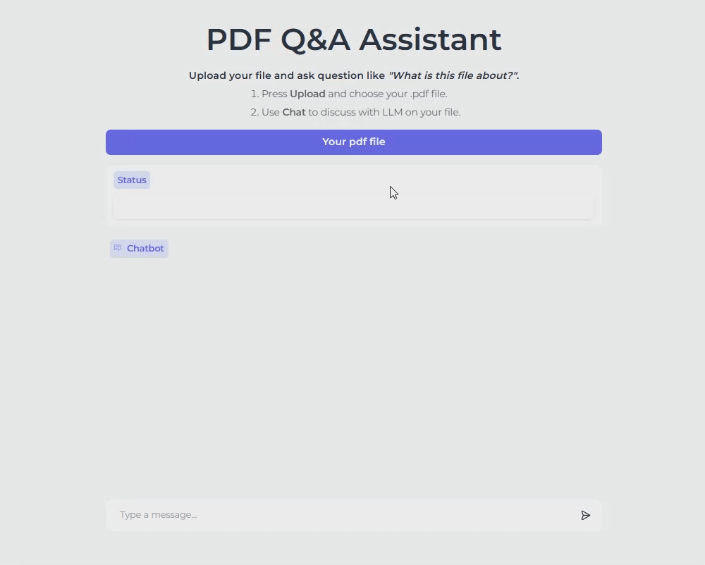
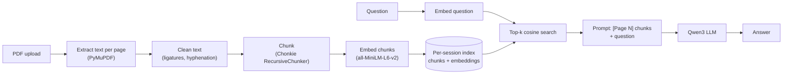

# PDF Q&A Assistant



A small retrieval-augmented generation (RAG) app: upload a PDF, ask questions, and get answers based only on the content of that file. Built with PyMuPDF, Chonkie, Sentence-Transformers, a Qwen3 language model, and Gradio. 

**Live demo:** https://huggingface.co/spaces/Canaximui1302/pdf_rag

## Features

- Upload one PDF and ask questions in a chat box.
- Answers are grounded in retrieved passages. The model is instructed to say so when the document does not contain the answer.
- Every chunk keeps its page number, and the context given to the model is labeled `[Page N]`, so answers can point back to pages.
- Each visitor gets their own index (`gr.State`), so documents are never mixed between sessions.
- Everything runs locally: no external API or inference service is needed.

## How it works



**Indexing (once per uploaded PDF)**

1. **Read.** PyMuPDF extracts text block by block for each page, keeping the page number.
2. **Clean.** Ligatures are normalized (NFKC), soft hyphens removed, words split across lines are rejoined, and line breaks inside paragraphs become spaces.
3. **Chunk.** Chonkie's `RecursiveChunker` splits each page into chunks of roughly 750 characters at paragraph and sentence boundaries. Chunking is done page by page, so every chunk has exactly one page number.
4. **Embed.** `sentence-transformers/all-MiniLM-L6-v2` turns each chunk into a normalized 384-dimensional vector.
5. **Store.** Chunks and their embeddings are kept together in a dictionary (`{"chunks": [...], "embeddings": tensor}`), stored per session in `gr.State`. Row *i* of the embedding matrix always matches `chunks[i]`.

**Answering (every question)**

1. The question is embedded with the same model (`encode_query`).
2. Cosine similarity against all chunk embeddings gives a ranking, and the top-k chunks are kept.
3. The chunks are formatted as plain text with `[Page N]` labels and placed in the prompt together with the question.
4. A Qwen3 model answers using only that context. A system prompt tells it to reply briefly and to say when the answer is not in the document.

## Project structure

```
.
├── app.py             # Gradio UI: upload button, status box, chat interface
├── file_index.py      # PDF reading, cleaning, chunking, embedding, retrieval
├── llm.py             # Model loading and answer generation
├── requirements.txt
└── README.md
```


## Installation

Requirements: Python 3.12 (tested), and ideally an NVIDIA GPU. A CPU also works but generation will be slow.

```bash
git clone <your-repo-url>
cd <your-repo-name>

# create and activate a virtual environment
python -m venv .venv
source .venv/bin/activate        # macOS / Linux
.venv\Scripts\Activate.ps1       # Windows PowerShell
```

**Install PyTorch first**, choosing the build for your hardware at <https://pytorch.org/get-started/locally/>. On Windows a plain `pip install torch` can give a CPU-only build, so use the command from that page (for an NVIDIA GPU it includes an `--index-url` for a CUDA build). Then:

```bash
python -m pip install -r requirements.txt
```

Check that the GPU is visible:

```bash
python -c "import torch; print(torch.__version__, torch.cuda.is_available())"
```

## Run locally

```bash
python app.py
```

Open the local URL printed in the terminal (by default `http://127.0.0.1:7860`). The first start downloads the language model and the embedding model from the Hugging Face Hub, which can take a few minutes. Neither model requires a login token.

1. Click the upload button and choose a `.pdf` file. The status box shows how many chunks were indexed.
2. Type a question in the chat box.

## Testing locally

**1. Smoke test.** Start the app, upload any text-based PDF, and ask "What is this document about?"

**2. Test retrieval on its own** (no LLM needed). This is the fastest way to debug chunking and embedding:

```python
import file_index as fi

pages = fi.pdf_r("bert.pdf")
index = fi.embed_doc(pages)
print(len(pages), "pages ->", len(index["chunks"]), "chunks")

for r in fi.retrieve_text(index, "On how many NLP tasks did BERT set a new state of the art?", 6):
    print(r["page"], round(r["score"], 3), r["text"][:120])
```

Read the printed chunks. They should start and end at sentence or paragraph boundaries, with no stray ligatures or broken words.

**3. Test end to end with a known paper.** Download the BERT paper ([arXiv:1810.04805](https://arxiv.org/abs/1810.04805), latest version) and try these questions:

| Question | Expected answer |
|---|---|
| On how many NLP tasks did BERT set a new state of the art? | Eleven |
| What GLUE score did BERT reach? | 80.5% |
| What was the SQuAD v1.1 test F1? | 93.2 |
| What was the SQuAD v2.0 test F1? | 83.1 |
| What are the two steps of the BERT framework? | Pre-training and fine-tuning |
| How are sentence pairs chosen in next sentence prediction? | 50% of the time B is the true next sentence, 50% a random one |
| How many labeled training examples does MRPC have? | 3,600 |

**4. Test refusals.** The model should say it could not find the answer, and should not invent one:

- "What is the capital of France?"
- "How many parameters does GPT-4 have?"
- "What BLEU score did BERT get on machine translation?"

For each question, note whether the correct chunk was retrieved (step 2) and whether the answer was correct. A wrong answer with the right chunk points to the model or the prompt. A wrong answer without it points to chunking or embedding.

## Credits

Built by Nguyen Ho Minh Khanh.

This project stands on the work of others:

* PyMuPDF (Artifex) for PDF text extraction.
* Chonkie for text chunking.
* Sentence-Transformers and the all-MiniLM-L6-v2 embedding model.
* Qwen3 by the Qwen team at Alibaba Cloud, used as the language model.
* Transformers and PyTorch for model loading and inference.
* Gradio for the user interface.
* Hugging Face for the Hub, Spaces, and ZeroGPU.
* The BERT paper (Devlin et al., arXiv:1810.04805), used as the test document, and the original RAG paper (Lewis et al., 2020) for the overall approach.